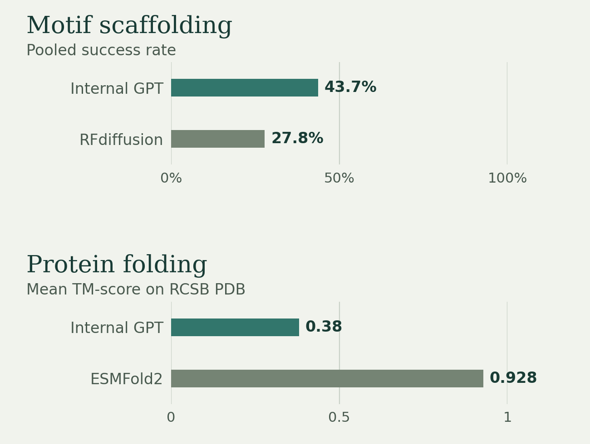

OpenAI's latest paper, [GPT-6 as a Universal Foundation Model for Protein Biology: Beyond Specialized Models](https://cdn.openai.com/pdf/gpt-6-a-universal-foundation-model-for-protein-biology.pdf), demonstrates the remarkable capabilities of general-purpose language models in protein biology.

Compared with previous studies in which LLMs act as agents orchestrating specialized models such as AlphaFold, RFdiffusion, or ProteinMPNN, what makes this work particularly interesting is that GPT can solve complex protein-related problems using only its own knowledge, reasoning, and code execution, without invoking pretrained specialized protein models during candidate generation.

However, a closer examination of the experimental results reveals a fascinating asymmetry in its capabilities:

- In protein backbone design, the latest internal model already outperforms RFdiffusion on some tasks.
- In motif scaffolding, the internal model achieves a success rate of 43.7%, compared with 27.8% for RFdiffusion.
- In inverse folding, GPT achieves performance comparable to ProteinMPNN.
- In molecular docking and side-chain packing, GPT demonstrates remarkably strong capabilities.
- Yet in the classical protein folding task, the internal model achieves a mean TM-score of only 0.38 on the PDB benchmark, compared with 0.928 for ESMFold2.

<figure class="inline-figure">
  
  <figcaption>Each panel compares models on the same task and metric. The folding result uses the internal model’s highest evaluated budget. <a href="https://cdn.openai.com/pdf/gpt-6-a-universal-foundation-model-for-protein-biology.pdf#page=13">Scaffolding results, p. 13</a> · <a href="https://cdn.openai.com/pdf/gpt-6-a-universal-foundation-model-for-protein-biology.pdf#page=33">Folding results, Fig. 22</a></figcaption>
</figure>

Why can a model capable of designing proteins still struggle to predict their structures?

I believe that understanding this phenomenon requires us to first examine how GPT actually solves these problems.

## 1. GPT Is Not a Protein Generative Model in the Traditional Sense

When we talk about RFdiffusion, Proteina, or other protein structure generation models, these models typically learn the distribution of protein structures through large-scale training and generate new three-dimensional structures using approaches such as diffusion or flow matching.

GPT, however, operates very differently in this study.

A closer reading of Section 6 and Appendix E reveals that GPT frequently adopts the following strategy:

1. Formulate structural hypotheses based on existing biological knowledge.
2. Translate these hypotheses into explicit geometric relationships and physical constraints.
3. Write custom code to construct candidate protein structures.
4. Define scoring functions and perform conformational search and numerical optimization.
5. Analyze computational results and revise structural hypotheses, search algorithms, or optimization objectives.
6. Output the final three-dimensional protein coordinates.

For example, on page 106 of the paper, GPT is tasked with generating an 81-residue ubiquitin-like backbone corresponding to CATH topology 3.10.20.

Drawing on its structural biology knowledge, GPT first proposes an overall structure consisting of five β-strands and an α-helix, determining the relative orientations and contact relationships between the strands.

It then writes a program to construct the protein backbone using bond lengths, bond angles, and torsion angles, while defining optimization objectives involving hydrogen-bond distances, steric clashes, and packing.

In early candidate structures, GPT discovers that two atom pairs have distances of 5.54 Å and 5.26 Å, substantially exceeding its intended hydrogen-bond distance of 2.95 Å.

Interestingly, rather than simply continuing to minimize the original objective function, GPT modifies some of its contact restraints and adjusts other structural parameters.

After sequence design and refolding with specialized models, the resulting backbone achieves a self-consistency RMSD of 0.807 Å and matches the requested CATH topology.

This process resembles a structural biologist designing computational experiments rather than a conventional generative model directly sampling structures.

GPT is not merely an optimizer. It also defines the optimization problem, designs the algorithm, and analyzes the computational results.

This ability to dynamically construct problem-solving algorithms at inference time may be one of the most interesting distinctions between general-purpose LLMs and conventional specialized biological models.

## 2. Why Is GPT So Good at Protein Design?

Protein design and protein folding appear to be closely related tasks, but they involve different search spaces and success criteria.

In protein folding, we are given a fixed amino acid sequence and must predict the structure adopted by that sequence under the corresponding physical conditions.

In protein backbone design, however, we only need to find a structure that satisfies the design requirements and is potentially designable.

For example, if the task is to design a stable protein containing three α-helices, the model does not need to recover a particular naturally occurring protein. Different helix lengths, orientations, loops, and spatial arrangements may all result in valid designs.

More importantly, the amino acid sequence is not predetermined in backbone design. We can first construct a reasonable backbone and subsequently identify sequences compatible with that structure.

This gives GPT considerable freedom.

GPT can leverage its existing biological knowledge, including:

- The geometric principles underlying α-helices and β-sheets;
- Appropriate distances and orientations for hydrogen bonding;
- Packing arrangements of hydrophobic cores;
- Common protein topologies;
- Geometric and chemical characteristics of protein surfaces.

It can then generate candidate structures satisfying the design requirements through programming, conformational search, and numerical optimization.

Even without accurately mastering the mapping from arbitrary amino acid sequences to three-dimensional structures, these capabilities can be sufficient for GPT to achieve strong performance on certain backbone design tasks.

Of course, this does not mean that protein design is generally easier than protein folding. Complex enzyme design, conformational control, and functional protein design can all be extremely challenging.

Another important consideration is that the backbone generation experiments in this study still rely on ProteinMPNN or SolubleMPNN for subsequent sequence design, as well as specialized models such as ESMFold2 for structural validation and candidate filtering.

The current results therefore demonstrate that GPT can serve as a powerful backbone generator, but they do not establish that it can independently complete the entire protein design pipeline.

## 3. How GPT Approaches Protein Folding: Top-Down Structural Reasoning

Compared with protein design, I find GPT's approach to protein folding even more interesting.

In the examples presented in Section 6.3.1 and Appendix E.3.1, GPT frequently starts from high-level biological information extracted from amino acid sequences and progressively constructs lower-level geometric structures.

This process can be broadly summarized as:

**Sequence → Protein Family → Global Fold → Secondary Structure Topology → Residue-Level Constraints → Atomic Coordinates**

For example, in the 6I3B case presented on page 147, GPT discovers that the input protein of 252 amino acids consists of six identical sequence repeats, each containing 42 residues.

From this observation, it infers that the protein may exhibit sixfold rotational symmetry and proposes a β-propeller structural hypothesis.

GPT then constructs a repeating structural unit, generates the complete structure through successive 60° rotations, and performs additional search and optimization of strand pairing, packing, and local conformations.

The final predicted backbone achieves an RMSD of 2.93 Å.

This is a particularly elegant example because GPT exploits a high-level pattern in the sequence to transform a complex three-dimensional structure prediction problem into a geometric problem with a substantially smaller search space.

Similarly, for other proteins, GPT leverages conserved sequence motifs, protein family knowledge, repetitive structures, or potential ligand-binding sites to infer the overall fold.

I believe this behavior can be understood as a form of hierarchical, top-down structural reasoning.

However, this strategy also has a fundamental weakness: **errors can propagate from high-level structural hypotheses to lower-level geometric construction.**

If GPT incorrectly identifies the protein family, secondary structure arrangement, or global topology at the beginning, subsequent numerical optimization may simply search for the most plausible solution within the wrong structural space.

Even if the resulting structure has reasonable bond lengths, bond angles, hydrogen-bond networks, and internal packing, it may still differ substantially from the native structure corresponding to the input sequence.

**Numerical optimization can make an incorrect structure more physically plausible without necessarily making it correct.**

## 4. GPT Is Using Pre-AlphaFold Protein Folding Strategies

GPT's problem-solving trajectories remind me of many computational structural biology methods that existed before AlphaFold.

Traditional protein structure prediction often involved a combination of:

- Protein family recognition and homology modeling;
- Secondary structure prediction;
- Fragment assembly;
- Physics-based or statistical scoring functions;
- Monte Carlo search, simulated annealing, and numerical optimization.

Early Rosetta methods, for example, used local structural fragment assembly, conformational sampling, and scoring functions to identify plausible protein structures.

Many of the behaviors demonstrated by GPT in this paper are conceptually similar to these traditional approaches.

Of course, GPT is not directly invoking Rosetta. What makes it distinctive is its ability to autonomously determine which structural hypotheses, search algorithms, and optimization objectives to use for each new protein, and dynamically implement the corresponding programs during inference.

From this perspective, GPT resembles a system capable of automatically creating and modifying traditional computational structural biology algorithms.

However, this does not automatically eliminate the fundamental difficulties associated with these methods.

First, constructing a sufficiently accurate scoring function remains extremely challenging.

Although the native state of a protein under appropriate conditions is associated with a minimum-free-energy conformational ensemble, a simple combination of hydrogen bonding, steric clashes, packing, and geometric restraints is not equivalent to the true physical free energy.

Second, even with an accurate energy function, finding the global optimum within a high-dimensional, nonconvex conformational space is itself an extraordinarily difficult problem.

GPT's powerful reasoning and numerical optimization capabilities may alleviate these difficulties, but they do not guarantee that the underlying problems can be fundamentally resolved.

## 5. AlphaFold's Breakthrough Was to Change How the Problem Is Solved

AlphaFold2 did not solve protein structure prediction simply by constructing more sophisticated handcrafted energy functions or performing more extensive conformational searches.

One of its most important breakthroughs was to directly learn sequence–structure relationships from large amounts of protein sequence, structural, and evolutionary data.

Through the Evoformer, AlphaFold2 jointly updates multiple sequence alignment (MSA) representations and residue-pair representations, allowing relationships between residues to be repeatedly communicated and refined.

The Structure Module then generates three-dimensional structures from these learned representations, while recycling further improves the predictions.

In contrast, GPT in this study frequently relies on explicit biological reasoning to infer:

- Which residues should form α-helices or β-strands?
- Which strands should be parallel or antiparallel?
- Which residues should be in spatial contact?
- Which backbone atoms should form hydrogen bonds?

However, knowing the geometric properties of hydrogen bonds in β-sheets and knowing precisely which residues in a specific sequence should form those hydrogen bonds are two different capabilities.

The former can be acquired from structural biology knowledge expressed in natural language.

The latter requires an accurate understanding of the complex, context-dependent statistical relationships between protein sequences and three-dimensional structures.

AlphaFold acquires strong capabilities in the latter through end-to-end training, whereas GPT, in the problem-solving trajectories demonstrated here, still relies substantially on the former.

This does not mean that AlphaFold lacks hierarchical reasoning, nor does it imply that GPT has not learned any implicit structural representations. The distinction discussed here concerns the observable problem-solving strategies of the two models, rather than assumptions about GPT's undisclosed internal architecture.

## 6. Why Is GPT So Good at Docking?

Another particularly noteworthy observation in this paper is GPT's strong performance on molecular docking.

When provided with complete atomic protein structures, the internal model achieves a mean DockQ of 0.96 for antibody–antigen docking and a mean GlobalDockQ of 0.95 for multimer docking.

Even when only backbone coordinates are provided, the corresponding scores reach 0.81 and 0.85.

I believe this shares some of the underlying reasons why GPT performs well in protein design.

In rigid-body protein–protein docking, the three-dimensional structures of both proteins are already provided. For the simplest two-body rigid docking problem, once one protein is fixed, we only need to optimize three translational and three rotational degrees of freedom for the other protein.

In contrast, predicting the complete structure of a 100-residue protein requires considering hundreds of backbone torsion angles and numerous coupled long-range spatial relationships.

The search spaces of these two problems differ substantially.

In docking, GPT can analyze surface geometry, spatial complementarity, charge distributions, potential hydrogen bonds, and other chemical interactions using the available structures. It can then write custom programs to search for reasonable relative positions and orientations.

Rather than inferring the complete folds of both proteins from scratch, it can solve a relatively constrained geometric problem within an already established structural space.

This characteristic aligns particularly well with GPT's strengths in reasoning, coding, and numerical optimization.

The side-chain packing and antibody CDR structure prediction experiments demonstrate a similar phenomenon: when most of the three-dimensional structure is already provided, GPT's predictive performance becomes substantially more competitive with specialized models.

However, an important limitation of the protein–protein docking benchmark is that the input structures are directly extracted from experimentally determined complexes and therefore retain their bound-state conformations.

This is a more constrained setting than predicting binding between two independently obtained unbound proteins, where conformational changes may accompany complex formation.

Even more surprisingly, GPT also substantially outperforms the specialized model DiffDock-L in blind small-molecule docking.

On the PoseBusters benchmark, when the complete atomic structure of the receptor is provided, approximately 93% and 96% of predictions from GPT-6.2 and the latest internal model, respectively, achieve a ligand RMSD within 2 Å, compared with approximately 50% for DiffDock-L.

The internal model achieves a median ligand RMSD of 0.34 Å, compared with 1.89 Å for DiffDock-L.

GPT demonstrates similarly substantial advantages on the SCARPiNo covalent docking benchmark.

Unlike rigid-body protein–protein docking, GPT is not given the three-dimensional structure of the ligand in small-molecule docking. Instead, it receives only the ligand SMILES and the receptor protein structure.

Nevertheless, I believe this task still falls within GPT's comfort zone of numerical optimization.

First, SMILES already specifies the atomic composition and chemical connectivity of the small molecule. GPT does not need to infer its chemical structure from scratch; it only needs to generate reasonable three-dimensional conformations.

Second, the internal conformational degrees of freedom of a small molecule are typically far fewer than those of a complete protein. In addition to global translation and rotation, the model primarily needs to consider rotatable bonds and other internal conformational changes.

Finally, and most importantly, the three-dimensional structure of the receptor protein is already provided. The model can directly analyze the geometry, spatial constraints, and chemical environment of potential binding pockets, using this information to substantially narrow the search space of ligand conformations and binding sites.

The problem-solving examples in Section 6.3.4 and Appendix E.3.4 also support this interpretation.

GPT uses RDKit to generate ligand conformations, employs the Merck Molecular Force Field (MMFF) to reduce internal molecular strain, and writes custom programs to search ligand poses.

It can also define scoring terms for hydrogen bonding, electrostatic interactions, metal coordination, and steric clashes based on the specific molecular environment, allowing it to compare and optimize candidate conformations.

These behaviors fundamentally involve leveraging biological and chemical knowledge to transform a complex molecular prediction problem into a relatively constrained geometric search problem.

Therefore, GPT's excellent performance in small-molecule docking is not inconsistent with its relatively weak performance in protein folding.

The former already provides substantial reliable structural information and primarily requires identifying reasonable molecular arrangements within a constrained conformational space. The latter requires inferring the entire three-dimensional organization of a protein from a one-dimensional sequence.

**GPT currently appears to excel at constrained geometric search and optimization, while remaining substantially limited in its ability to infer complete, unknown global structures from sequence alone.**

Of course, this interpretation does not mean that docking itself is a simple problem, nor does it establish that GPT has surpassed all specialized docking models.

The receptor structures used in the paper, the supplied attachment sites in covalent docking, computational budgets, potential training data memorization, and RMSD-based evaluation criteria are all important factors when interpreting these results.

Differences in search space offer a plausible explanation for these experimental observations, but they have not been established as a causal explanation through dedicated ablation studies.

## 7. GPT's Greatest Strength May Be Transforming Biological Problems into Computational Problems

Taken together, I believe GPT's current strengths in protein biology can be summarized as follows:

**Leveraging existing biological knowledge to identify structural patterns, translating those patterns into mathematical constraints, and solving the resulting problems through autonomous programming, conformational search, and numerical optimization.**

When a task has clearly defined objectives, provides substantial structural information, or allows the model to freely choose reasonable design solutions, these capabilities can be particularly effective.

This may explain why GPT demonstrates strong performance in:

- Protein backbone design;
- Motif scaffolding;
- Inverse folding;
- Molecular docking;
- Side-chain packing;
- Local structure prediction.

However, when a task requires recovering a complete and accurate three-dimensional structure from an arbitrary amino acid sequence, explicit biological knowledge and reasoning may still be insufficient to provide the necessary spatial constraints.

In particular, for sequences without obvious repetitive patterns, familiar sequence motifs, or easily recognizable protein families, GPT may struggle to identify the correct global structure through high-level biological reasoning alone.

Therefore, GPT's primary bottleneck may not simply be the need for more powerful numerical optimization, but rather the ability to acquire more accurate, comprehensive, and generalizable structural priors.

## 8. The Future of General-Purpose LLMs and Protein Foundation Models

This paper does not convince me that specialized protein foundation models are becoming obsolete.

On the contrary, it makes me even more curious about whether the high-level biological reasoning capabilities of general-purpose LLMs can be genuinely integrated with the fine-grained sequence–structure representations learned by specialized protein models.

GPT can currently formulate structural hypotheses using knowledge expressed in natural language and dynamically create algorithms to solve problems.

Specialized models such as AlphaFold and ESM, meanwhile, can learn relationships between protein sequences, structures, and functions from large-scale biological data—relationships that may be extremely difficult for humans to explicitly articulate in natural language.

These two capabilities may be highly complementary.

Ideally, a future multimodal protein foundation model should not only be able to explain protein structures and functions in natural language, but also directly understand, predict, and generate precise residue-level interactions, three-dimensional geometries, and protein sequences.

Such a model should not exclusively reason from high-level biological knowledge down to structural details. It should also learn from low-level sequence and geometric information and use that information to revise its high-level biological hypotheses.

This form of bidirectional, multi-level reasoning may be more interesting to explore than simply scaling language models or training increasingly powerful specialized protein structure generation models.

OpenAI's work demonstrates that general-purpose language models can already exhibit remarkable scientific problem-solving capabilities across a wide range of protein-related tasks.

But I believe it also reveals an important distinction:

**Knowing the rules of protein biology is not necessarily the same as learning the underlying distribution of proteins.**

Understanding the principles that govern proteins and actually learning the intrinsic relationships between protein sequences, structures, and functions are not entirely equivalent capabilities.

How to unify these two forms of intelligence may be one of the most interesting questions for the next generation of biological foundation models.
